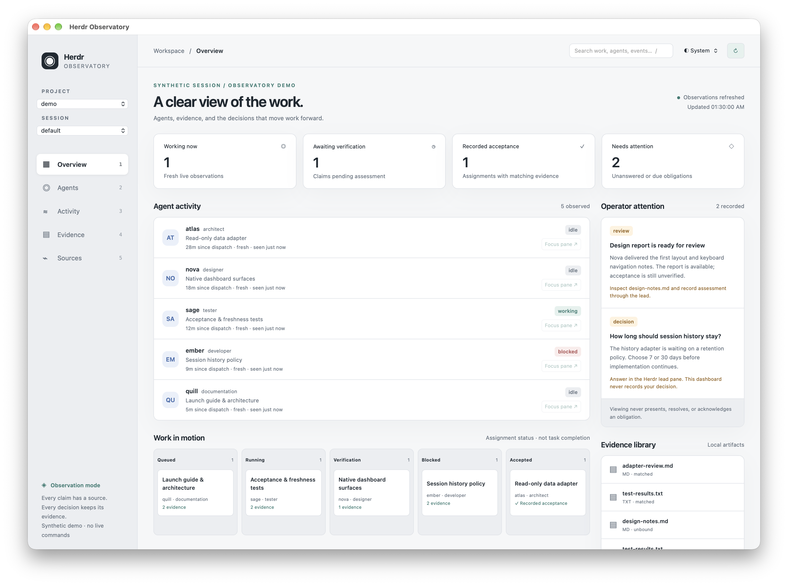

# Herdr Observatory

A local, observational dashboard for Herdr coding sessions, running in a native Glimpse window. Track assignments, live activity, unanswered obligations, reports, and recorded acceptance without interrupting supervision.



## Launch

Requires [Node.js 22+](https://nodejs.org/), macOS, and existing [Xcode Command Line Tools](https://developer.apple.com/xcode/resources/) for Glimpse's Swift host. Development was verified on macOS with Node 26.11.1 and Herdr 0.9.4. No cloud account or credentials are needed.

```sh
npm ci
npm run demo
```

Close the window or press Ctrl-C in the launching terminal to stop. Demo data is synthetic, uses a fixed observation clock, and never calls Herdr. Restarting restores the same fixture view; the dashboard does not modify fixtures.

If Glimpse's installer skipped native compilation, run `npm rebuild glimpseui` with the existing Swift toolchain. No machine-level tools are installed by this repository.

For actual data, supply the project and the teamlead state file explicitly:

```sh
npm start -- \
  --project /absolute/path/to/project \
  --state /absolute/path/to/state.json \
  --session default \
  --ledger /absolute/path/to/reports/TASK-LEDGER.md \
  --evidence-root /absolute/path/to/reports
```

Use an existing Herdr session name. The application calls only `herdr --session NAME api snapshot` during observation. It never launches or attaches a session. `--ledger` and `--evidence-root` are optional; repeat evidence roots for additional report directories.

Repeat `--project` and `--session` to populate the selectors. Project selection scopes live panes and Beans issues. The explicitly supplied state file defines the assignment and attention scope; shared teamlead history can span projects and sessions. Use `--task EXACT_TASK_ID` to limit that shared history to a particular task. Launch separate windows for different state files. The UI exposes source paths and does not guess project ownership from task names.

Inspect the same normalized data without opening a window:

```sh
npm start -- --project /absolute/path/to/project --state /absolute/path/to/state.json --snapshot
npm run demo -- --snapshot
```

Use `npx tsx src/cli.ts ... --snapshot` for JSON-only stdout without npm's script banner.

## What the dashboard shows

- **Agent activity:** recorded role and task, live lifecycle, elapsed time since dispatch, last observation, and freshness. A native session mismatch leaves the live agent unassigned instead of attaching historical work to a reused name.
- **Assignment board:** queued, running, awaiting verification, blocked, and accepted. Each card opens its assessment, provenance, evidence, and recorded commit reference. This board tracks assignments; it does not manufacture task-wide completion.
- **Activity:** dispatches, supervision observations, findings, corrections, attention events, and resolutions, sorted by event time with sequence tie-breaks.
- **Operator attention:** open and deferred obligations replayed from the owner's append-only history. Viewing never records presentation, acknowledgement, or resolution.
- **Evidence:** safe Markdown headings and code blocks, plain test/log output, image previews, recorded digests, and commit references. Raw HTML and report scripts remain inert text. Markdown links and embedded resources are not fetched.
- **Sources:** exact paths, read times, file modification times, errors, and saved watcher heartbeat status. A fresh heartbeat does not establish process identity or supervision health by itself.

Choose system, light, or dark appearance in the toolbar. Tab through controls; `/` focuses search, `1`–`5` changes views, and Escape closes the evidence drawer. Live DOM updates preserve retained controls, focus, scroll position, and expanded ledger context using [morphdom](https://github.com/patrick-steele-idem/morphdom).

**Open local file** revalidates a known evidence path before using macOS `open`. **Focus pane** rechecks the live pane occupant, project, and native session before issuing `herdr agent focus`. Explicit focus can mark a Herdr completion seen. Neither action runs automatically; demo focus is disabled. Dispatch, cancellation, approval, and state editing are absent.

## Acceptance is deliberately conservative

An assignment appears accepted only when:

1. An applied owner dispatch binds the exact assignment index, worker, role, and task.
2. Its matching supervision enrollment is explicitly resolved and inactive.
3. The resolution outcome is the exact value `accepted`.
4. Nonempty evidence receipts bind files whose current bytes, sizes, and SHA-256 digests match.

The owner permits free-text resolution outcomes. A sentence containing “accepted” is shown verbatim as an **unclassified resolution**, never parsed into status. Changed, missing, or inaccessible receipts withdraw verified acceptance. An idle/done agent, an existing report, a green build, a Beans completed issue, and the Markdown ledger never establish acceptance. Recorded assignment acceptance is historical evidence, not approval of the current repository head or an entire release.

## Verification

```sh
npm run verify
```

The test suite covers normalization, chronological ordering, freshness, explicit acceptance, changed evidence, schema failures, attention replay, session mismatch, path and symlink boundaries, inert content, image signatures, bridge serialization, and bounded polling. Tests use temporary files and controlled clocks.

The browser interaction check runs the exact HTML and installed local morphdom asset used by Glimpse:

```sh
# Use an already-installed compatible browser:
OBSERVATORY_CHROMIUM='/Applications/Google Chrome.app/Contents/MacOS/Google Chrome' npm run screenshots
# Or install Playwright's matching browser in your environment, then:
# npx playwright install chromium
# npm run screenshots
```

It checks both appearances, keyboard navigation, search, focus trapping, preserved node identity/focus/scroll across refresh, updated click handlers, expanded ledger, evidence drawer isolation, inert malicious fixture text, and zero remote requests. It regenerates the browser screenshots in `docs/screenshots/`. Native capture and the platform-bound launch procedure are documented in [verification notes](docs/verification.md).

## Scope and limitations

- macOS is the validated target. Glimpse supports other hosts, but local-file opening is currently macOS-only and other platforms have not been exercised.
- Supported owner formats: teamlead state 6, assignments 6, snapshots 3, recovery 9, supervision 1, attention 1. Unsupported versions fail closed per source and remain untouched. This reader never invokes migrating owner commands.
- Files refresh on watcher hints and every five seconds. Herdr subprocesses time out after 2.5 seconds, have bounded output, and never overlap dashboard refreshes. Missing directories fall back to polling. No state locks are created.
- Source files are read independently. Cross-file transactions are not atomic; transient inconsistencies cannot grant acceptance without matching identities and evidence. Failed reads show diagnostics and retry, without retaining an old accepted result.
- The evidence index is capped at 300 artifacts; Beans at 200 issues; timeline at 500 newest events. Evidence reads require regular files under configured canonical roots. Source/receipt file limit is 16 MiB; viewer limits are 2 MiB text and 8 MiB images. PNG, JPEG, and WebP are supported; HTML, SVG, PDF, executables, and arbitrary URLs are refused.
- Native pane focus and macOS external-file opening were not executed against existing user sessions during validation. Their guards are implemented; the passive integration and native window were exercised. No existing session or supervision state was modified.
- No remote event streaming, automatic project-to-task inference, persistence, task dispatch, approval, cancellation, or task-wide acceptance engine is included.

See [architecture](docs/architecture.md), [ADRs](docs/adr/0001-read-only-companion.md), [morphdom decision](docs/adr/0002-incremental-dom-updates.md), and [verification](docs/verification.md). Work is tracked in Beans; `beans list` shows the delivery task and follow-ups. Dependencies are pinned with a lockfile and weekly Dependabot checks.
