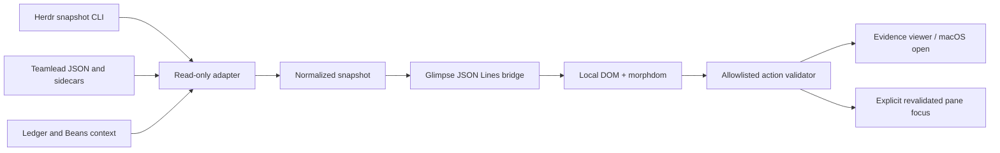

# Architecture

The CLI is a standalone companion. Inspection of Herdr 0.9.4 found built-in integrations for named coding agents and a structured socket snapshot API, but no supported third-party dashboard registration contract. The application uses Glimpse 0.8.1 as its native UI host.

## Boundaries

`src/adapter.ts` reads independently owned files, validates accepted schema versions, filters live panes to the selected project, hashes report receipts, and gathers source metadata. File events are hints, debounced at 200 ms; five-second polling supplies fallback and live status. Refreshes do not overlap. Each Herdr subprocess has a 2.5-second timeout and a 4 MiB output limit. Failure of one source does not prevent displaying the others.

`src/domain.ts` normalizes records without I/O or clock access. Its injected clock controls freshness and ordering. It keeps assignment indices intact, correlates exact dispatch identities, and separates recorded activity, pending verification, and explicit evidence-backed assignment acceptance. Native session identity is required before attaching live work to a historical assignment. Attention presentation is independent of resolution.

`src/actions.ts` accepts only known evidence IDs or known live agent IDs from the current snapshot. Evidence IDs derive from path and receipt digest, so list reordering cannot redirect an open action. Paths are canonicalized and checked against explicit roots; symlink escapes, large files, executable types, and mismatched image signatures are refused. Evidence reads return current content digests and observation times. Focus rereads the live snapshot and checks pane, name, cwd, and native session before the supported command.

`src/presentation.ts` resolves the installed morphdom UMD asset from local node_modules and inserts it into the trusted UI template in memory. There is no vendor copy, CDN, local HTTP listener, bundler, or frontend server. `ui/index.html` constructs all foreign strings with DOM textContent. Its restrictive CSP blocks remote resources, connections, base URLs, and form actions. Trusted inline scripts/styles support Glimpse's in-memory document. Reports cannot supply scripts, attributes, actions, or links.

`src/cli.ts` configures explicit paths, drives selection and polling, and serializes snapshots into a fixed JavaScript receiver. Glimpse's `win.send()` evaluates JavaScript; it is not a JSON message method. `bridgeCall()` encodes all payloads as JSON and escapes HTML delimiters and Unicode line separators. Incoming UI messages are untrusted and validated against configured projects, sessions, agents, and evidence.

## Observation contract

The application does not call teamlead owner readers, migrate files, acquire owner locks, acknowledge events, write attention, read terminal transcripts, or send agent input. Only explicit focus invokes a Herdr control command; it can mark completion seen. Opening evidence launches the user's local file handler only after a click and validation. State is transient in the companion process and the window.

A reader cannot prove the current source is globally consistent during an owner's multi-file transaction. Schema and exact identity checks, content receipts, visible freshness, and conservative acceptance limit the claim. A current report match verifies recorded bytes; it does not independently reproduce tests or verify an arbitrary commit against the working tree.

## Data contracts

- **Teamlead:** state 6, assignment 6, measurement snapshot 3, recovery 9; dispatch `assignment_index` refers to the preserved owner's array order.
- **Supervision:** schema 1 members, events, resolutions, watchers, and readable file receipts. `resolution.outcome` remains free text. Only exact `accepted` plus matched receipts is treated as an explicit acceptance classification.
- **Attention:** schema 1 append-only events with monotonic timestamps and optimistic revision numbers. Unknown actions or corrupt replay mark the source unusable, never an empty healthy inbox.
- **Ledger / Beans:** narrative and workflow context only. No Markdown or issue status is promoted into acceptance.
- **Glimpse:** `open(html, {width, height, title})`; incoming `message`, `closed`, and `error` events; outgoing fixed `win.send(js)` calls. UI `ready` establishes the bridge before polling starts.

This repository has no public server or durable writer schema. The owner schemas remain authoritative. Supporting a new owner version requires a reader update and regression fixtures, never in-place migration.

## Build and distribution

The source entry point runs through tsx during development. `npm run build` compiles production modules to gitignored dist/; bin/herdr-observatory.mjs calls the compiled CLI. npm prepare builds on packing and Git source installation. The npm files allowlist carries the executable, compiled modules, trusted UI, and portable synthetic fixtures. Runtime paths use the installed package root, so npm exec works from an unrelated directory. No global install or npm registry publication is required. ADR 0003 records this boundary; `npm run package:check` exercises the prepared package from an empty directory.
